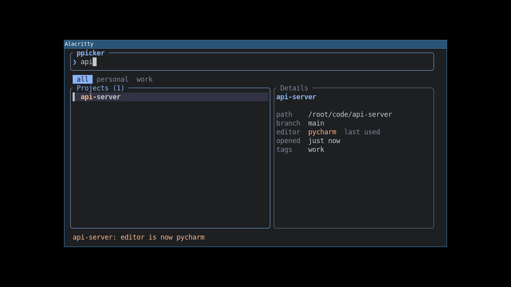

# ppicker



A tiny, instant project and runner picker for tiling window managers.
Press a hotkey, type a few letters, hit Enter: your IDE opens, or a script runs.
No typing paths, no dozens of hotkeys.

- ~1 MB single binary, starts in milliseconds
- Fuzzy search, tag filters, git branch and last-opened preview
- Actions auto-detected: IDEs, `cargo`, `npm`/`pnpm`/`yarn`/`bun` scripts, `uv`, `just`, `make`, `docker compose`, `git`
- Works as a built-in TUI or through rofi / wofi / fuzzel / fzf

## Install

```shell
pipx install ppicker     # or: uv tool install ppicker
cargo install ppicker
```

The command is `pp`.

## Use

```shell
pp add .                  # register the current directory
pp scan ~/code -t work    # register every git repo inside ~/code
pp                        # open the picker
pp menu                   # pick through rofi instead
pp run myproj "git pull"  # no UI
```

Keys: type to search, `Enter` for actions, `1`-`9` to run an action, `Ctrl-o` to open the
project in its editor immediately, `Tab` to cycle tags, `Esc` to go back / quit.

### Choosing an editor per project

A project you have never opened uses the global default editor (the first entry of `ides`
in the config). **Whichever editor you open a project with becomes that project's editor**:
next time it is the first action, marked `★ last used`, and `Ctrl-o` opens it straight away.
This applies to the picker, `pp run` and `pp menu`. Running a non-editor action such as
`git pull` leaves it alone.

To choose one without opening the project:

- In the picker, `Ctrl-e` steps the selected project through your configured editors
  (and wraps back to the global default). The details pane shows `editor  pycharm  last used`.
- In the action list, move to any "Open in ..." line and press `d`.
- From the command line:

```shell
pp editor myproj              # show the current editor
pp editor myproj pycharm      # set one (any command works, it need not be in `ides`)
pp editor myproj --reset      # forget it, back to the global default
pp add . --ide pycharm        # register and set in one go
```

## i3 / sway

```
bindsym $mod+p exec --no-startup-id alacritty --class pp-popup,pp-popup -e pp
for_window [class="pp-popup"] floating enable, resize set 960 520, move position center
```

Or with rofi: `bindsym $mod+p exec --no-startup-id pp menu`.
Other launchers: `pp menu --cmd "fuzzel --dmenu"` (`{prompt}` is replaced by the step name).

## Config

`pp paths` prints the locations. `config.toml`:

```toml
ides = ["code", "pycharm"]   # editors offered for projects; the first is the global default
scan_dirs = ["/home/me/code"]
```

Per-project actions go in `<project>/.ppicker.toml`:

```toml
[[action]]
label = "Dev server"
cmd = "npm run dev"
```

## Migrating from `code-compass` 0.1.x

This is the successor to the Qt-based `code-compass` package. To carry your projects over:

```shell
pipx install ppicker
pipx run code-compass==0.2.0 migrate   # reads the old database, pipes it into `pp import -`
```

Or just re-add them with `pp scan ~/code`.
