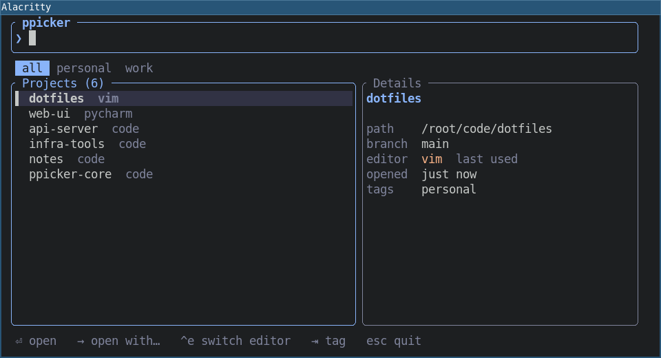
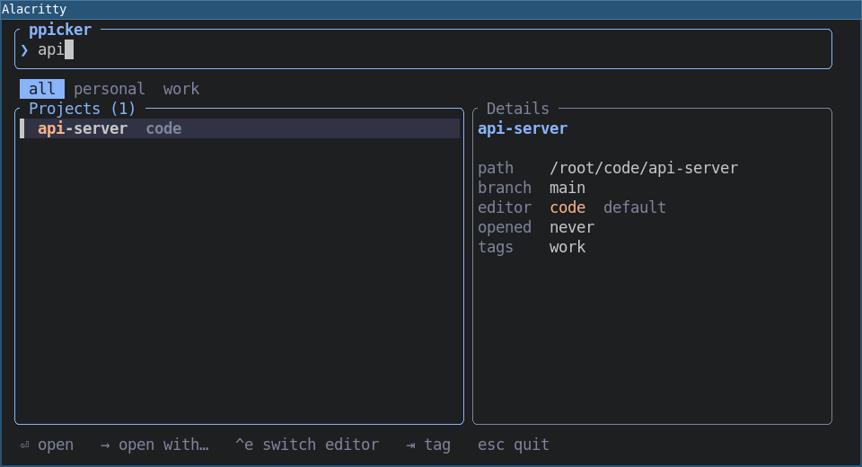
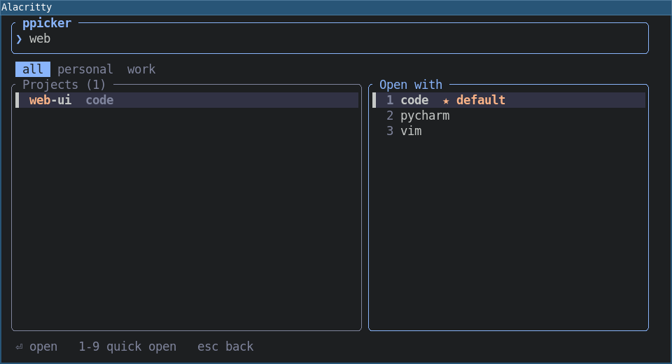
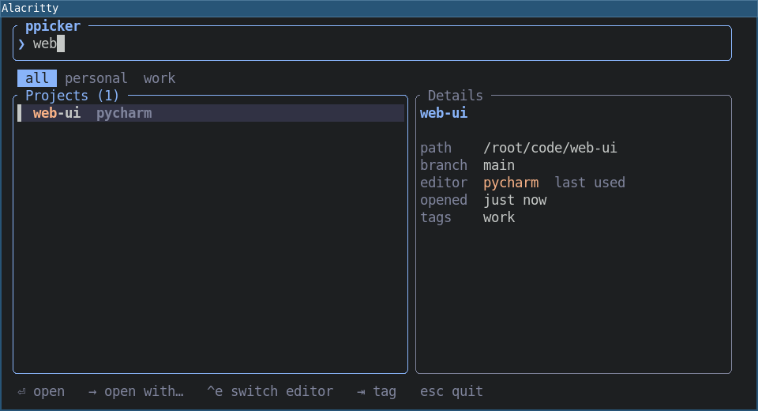
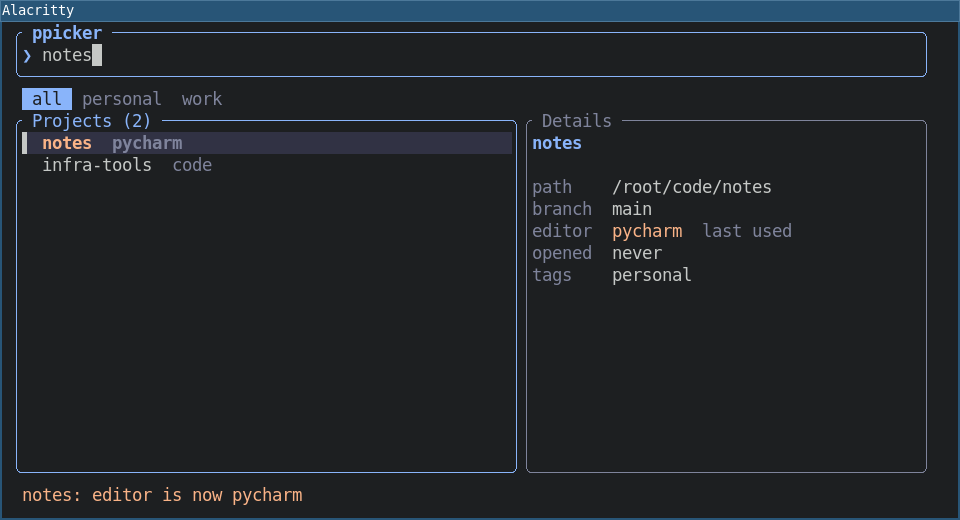
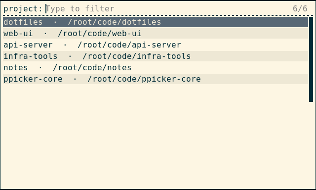
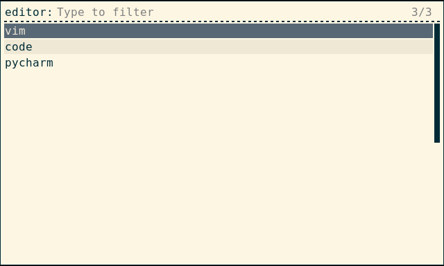

# ppicker



Press a hotkey, type a few letters, hit Enter: the project opens in your editor.
No typing paths, no dozens of hotkeys, no remembering which editor goes with which project.

ppicker is a ~1 MB program that starts instantly. It was built as a popup for tiling window
managers (i3, sway) but works in any terminal, and through rofi, wofi, fuzzel or fzf if you
prefer those.

- Fuzzy search over project names and paths, with tag filters
- Opens the project in the editor you used last time, per project
- Shows the git branch and when you last opened each project
- Linux is the main target; macOS and Windows build and pass the tests in CI

## Quick start

**1. Install.** The command it gives you is `pp`.

```shell
pipx install ppicker      # or: uv tool install ppicker
cargo install ppicker     # alternative
```

**2. Tell it about your projects.**

```shell
pp scan ~/code            # adds every git repository directly inside ~/code
pp add ~/work/shop        # or add one by hand ("pp add ." for the current directory)
```

**3. Open the picker.**

```shell
pp
```

**4. Bind it to a key** so it pops up when you need it. See [i3 / sway](#i3--sway).

## How it works

### Find a project

Start typing. ppicker matches against the project name *and* its path, so `shop` or `work/sh`
both find `~/work/shop`. The list narrows as you type, the best match is on top, and the matched
letters are highlighted. Projects you opened recently come first when the search box is empty.



The right-hand panel shows what you are about to open: the path, the current git branch, which
editor will be used, when you last opened it, and its tags. Press `Tab` to filter by a tag
(`work`, `personal`, ...) and `Shift-Tab` to go back.

### Open it

Press **Enter**. The project opens in its editor and ppicker closes. The editor is started in
the project's folder and keeps running on its own, so closing the terminal does not close it.

The first time you open a project, it uses your default editor, the first one in your config
(see [Editors](#editors)). After that it uses whichever editor you opened it with last.

### Open it with a different editor

Press **→** (right arrow) instead of Enter to choose an editor for this one.



Pick one with the arrow keys and Enter, or press its number (`1`-`9`). The project opens, and
ppicker remembers your choice for next time.

### It remembers

Whichever editor you open a project with becomes that project's editor. The list shows it next
to each name, and Enter uses it.



So you can keep a Python service in PyCharm, your dotfiles in vim and everything else in VS Code,
and never think about it again. Just press Enter.

### Change the editor without opening the project

Press **Ctrl-e** to step the selected project to the next editor in your list. It is saved at
once and a note at the bottom tells you what changed. After the last editor it wraps back to your
default.



### Use rofi, wofi or fuzzel instead

If you already have a launcher you like, use it for the picking:

```shell
pp menu
```



It lists your projects, you choose one, and it opens in the remembered editor. Add `--ask` to get
a second step where you choose the editor:

```shell
pp menu --ask
```



For other launchers, pass the command to use: `pp menu --cmd "fuzzel --dmenu"` (or `wofi --dmenu`,
`fzf`). `{prompt}` in the command is replaced by the step name.

## Keys

| Key | What it does |
|---|---|
| type | search by name or path |
| `↑` `↓` (or `Ctrl-p` `Ctrl-n`) | move through the list |
| `Enter` | open the project in its editor |
| `→` | open with a different editor |
| `1`-`9` | in the editor list, open with that editor |
| `Ctrl-e` | switch the project's editor without opening it |
| `Tab` / `Shift-Tab` | next / previous tag filter |
| `Ctrl-u` | clear the search |
| `←` or `Esc` | back from the editor list; `Esc` in the main list quits |

## Editors

List the editors you use in the config file (run `pp paths` to see where it is). The first one is
the default for projects you have not opened yet:

```toml
ides = ["code", "pycharm", "vim"]
scan_dirs = ["/home/me/code"]     # used by `pp scan` when you give no folder
```

An editor is just a command. ppicker runs `<command> .` inside the project folder, for example
`code .` or `pycharm .`. Anything that opens a folder works, including `idea`, `zed`, `subl`,
`nvim` (see the note below for terminal editors) or `code -n`.

> **Terminal editors** such as vim or nvim need a terminal to run in. Use a command that starts
> one, for example `ides = ["code", "alacritty -e nvim"]`.

## Commands

Everything the picker does is also available from the command line:

```shell
pp                              # open the picker
pp open myproj                  # open a project without the picker
pp open myproj pycharm          # open with a specific editor (and remember it)
pp editor myproj                # show which editor a project uses
pp editor myproj pycharm        # set it without opening
pp editor myproj --reset        # forget it, back to the default editor
pp add . --ide pycharm          # register the current folder and set its editor
pp add . --name api -t work     # custom name, add a tag (repeat -t for more)
pp scan ~/code -t work          # add every git repository in a folder
pp list                         # show projects with their editors
pp rm myproj                    # remove from the list (files are untouched)
pp menu [--ask]                 # pick through rofi or another launcher
pp paths                        # where the config and project list are stored
```

`pp rm` only forgets the project; it never deletes anything on disk.

## i3 / sway

Open the picker in a small centred floating window on a hotkey. Add to `~/.config/i3/config`:

```
bindsym $mod+p exec --no-startup-id alacritty --class pp-popup,pp-popup -e pp
for_window [class="pp-popup"] floating enable, resize set 960 520, move position center
```

(In sway, use `app_id="pp-popup"` and `alacritty --class pp-popup` or `foot --app-id pp-popup`.)

Prefer rofi? One line is enough:

```
bindsym $mod+p exec --no-startup-id pp menu
```

## Where your data lives

Two small text files you can read and edit; `pp paths` prints the exact locations.

- `config.toml`: your settings (editors, scan folders).
- `projects.toml`: your projects, their tags, last-opened time and remembered editor.

## Moving from `code-compass`

ppicker replaces the old Qt-based `code-compass` package. See [docs/MIGRATION.md](docs/MIGRATION.md)
for what changed and how to bring your projects over:

```shell
pipx install ppicker
pipx run code-compass==0.2.0 migrate
```

## Development

```shell
cargo test                # unit tests
cargo clippy --all-targets -- -D warnings
```

A Linux end-to-end test that drives the real program inside i3 and rofi, and produces the
screenshots above, is described in [e2e/README.md](e2e/README.md).
